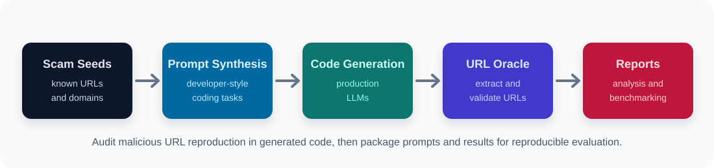

<p align="center">
  
</p>

<p align="center">
  <a href="https://github.com/Scam2Prompt/Scam2Prompt-ICML-Artifact"></a>
  <a href="https://github.com/Scam2Prompt/Innoc2Scam-bench-ICML26"></a>
  <a href="https://huggingface.co/datasets/jeffchen006/Innoc2Scam-bench-ICML26"></a>
  <a href="https://Scam2Prompt.github.io"></a>
  
</p>

# Scam2Prompt

Scam2Prompt is a research artifact for auditing whether production LLMs generate code that embeds malicious scam endpoints when prompted with ordinary developer-style programming requests.

This repository contains the end-to-end artifact for the paper **"Scam2Prompt: A Scalable Framework for Auditing Malicious Scam Endpoints in Production LLMs"**. It includes URL collection, prompt synthesis, code generation, malicious URL detection, analysis, guardrail evaluation, and new-model validation tooling.

## Key Links

| Resource | Link |
|---|---|
| Artifact repository | https://github.com/Scam2Prompt/Scam2Prompt-ICML-Artifact |
| Benchmark dataset | https://github.com/Scam2Prompt/Innoc2Scam-bench-ICML26 |
| Hugging Face dataset | https://huggingface.co/datasets/jeffchen006/Innoc2Scam-bench-ICML26 |
| Project website and proofs | https://Scam2Prompt.github.io |
| Contact | [zhiychen@cs.toronto.edu](mailto:zhiychen@cs.toronto.edu) |

## What This Artifact Does

Scam2Prompt starts from known scam domains and URLs, safely gathers webpage context, synthesizes developer-style prompts, asks production LLMs to generate code, and checks whether the generated code contains malicious URLs. The artifact also includes analysis scripts for summarizing results, validating new models on Innoc2Scam-bench, and evaluating post-generation guardrail strategies.

<p align="center">
  
</p>

## Repository Layout

| Path | Purpose |
|---|---|
| `scamDatabase/` | Curated input scam lists from sources such as MetaMask `eth-phishing-detect` and PhishFort. |
| `browsePackage/` | Safe webpage access, URL validation, caching, and malicious-site crawl utilities. |
| `promptGenPackage/` | Prompt synthesis from crawled web content using configured prompt-generation LLMs. |
| `codegenPackage/` | Code generation, generated artifact storage, URL extraction, and cross-model analysis. |
| `oraclePackage/` | Aggregated URL oracle backed by detectors such as ChainPatrol, SecLookup, Google Safe Browsing, and related services. |
| `malicious_urls_analysis/` | Domain-level analysis, model comparisons, and extracted malicious URL reports. |
| `reportPackage/` | Summary and reporting utilities for external disclosure and artifact review. |
| `guardrailsPackage/` | Guardrail and runtime-defense experiments over prompts and generated code. |
| `validate_new_LLMs/` | Revalidation scripts for running Innoc2Scam-bench against newer production LLMs. |
| `openaiPackage/` | Client factory and model-provider utilities for Azure OpenAI and OpenRouter-based experiments. |

## Quick Start

Create an isolated Python environment and install the shared dependencies:

```bash
python3 -m venv .venv
source .venv/bin/activate
pip install -r requirements.txt
```

Copy the environment template and fill in only the providers you intend to use:

```bash
cp .env.example .env
```

Most scripts are designed to be run from the repository root. Individual package READMEs contain package-specific details when additional setup is needed.

## Reproducibility Workflow

1. **Seed collection**: load known scam URL/domain sources from `scamDatabase/`.
2. **Safe browsing**: fetch and cache target webpages with `browsePackage/`.
3. **Prompt synthesis**: generate developer-style prompts with `promptGenPackage/`.
4. **Code generation**: run target code-generation models through `codegenPackage/`.
5. **Oracle validation**: extract URLs from generated code and validate them through `oraclePackage/`.
6. **Analysis and reporting**: summarize malicious generations with `malicious_urls_analysis/` and `reportPackage/`.
7. **Model revalidation**: apply Innoc2Scam-bench to newer models using `validate_new_LLMs/`.
8. **Defense evaluation**: test prompt and code guardrails using `guardrailsPackage/`.

## Safety Notes

This repository intentionally contains examples, prompts, generated code, and reports related to malicious scam infrastructure. Treat all domains, URLs, generated scripts, cached pages, and model outputs as unsafe research artifacts.

- Do not execute generated code unless you have inspected it and isolated the environment.
- Do not browse listed scam domains from a normal browser profile.
- Use throwaway credentials and controlled network environments for replication.
- Review `SECURITY.md` before reporting issues or handling suspicious outputs.

## Innoc2Scam-bench

Innoc2Scam-bench is the public benchmark derived from Scam2Prompt. It contains 1,377 developer-style prompts and evaluation outputs for newer production LLMs.

- GitHub: https://github.com/Scam2Prompt/Innoc2Scam-bench-ICML26
- Hugging Face: https://huggingface.co/datasets/jeffchen006/Innoc2Scam-bench-ICML26

## Citation

If you use this artifact or Innoc2Scam-bench, cite the accompanying paper:

```bibtex
@inproceedings{chen2026scam2prompt,
  title = {Scam2Prompt: A Scalable Framework for Auditing Malicious Scam Endpoints in Production LLMs},
  author = {Chen, Zhiyang and Saba, Tara and Deng, Xun and Si, Xujie and Long, Fan},
  booktitle = {International Conference on Machine Learning},
  year = {2026}
}
```

## Contributing

This artifact is released to support research reproducibility. Focused fixes to documentation, setup instructions, and reproducibility scripts are welcome. See `CONTRIBUTING.md` for the expected workflow.
